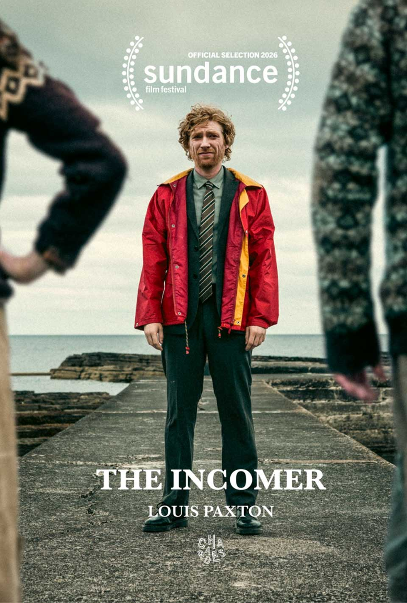

  

{: .img-fluid .rounded }
  

  

... Y si no, animaos a ver [The Incomer](https://www.filmaffinity.com/es/film243788.html "The Incomer"){:target="_blank"}, donde dos excéntricos hermanos ven alterada su aislada vida en una remota isla escocesa cuando un torpe funcionario llega con la orden de reubicarlos.

Simpática comedia ligera protagonizada por Domhnall, el hijo de un Brendan Gleeson al que seguro habréis visto en innumerables películas como en [Braveheart](https://www.filmaffinity.com/es/film395715.html "Braveheart"){:target="_blank"}, [Gangs of New York](https://www.filmaffinity.com/es/film478154.html "Gangs of New York"){:target="_blank"} o [Escondidos en Brujas](https://www.filmaffinity.com/es/film838496.html "Escondidos en Brujas"){:target="_blank"}.

Sin buscar reinventar la rueda, la película tiene ciertos toques de fábula y un humor absurdo (más bien ingenuo) que funciona gracias al carisma del trío protagonista. 

Cero pretensiones con hora y media de paisajes bonitos.
  

