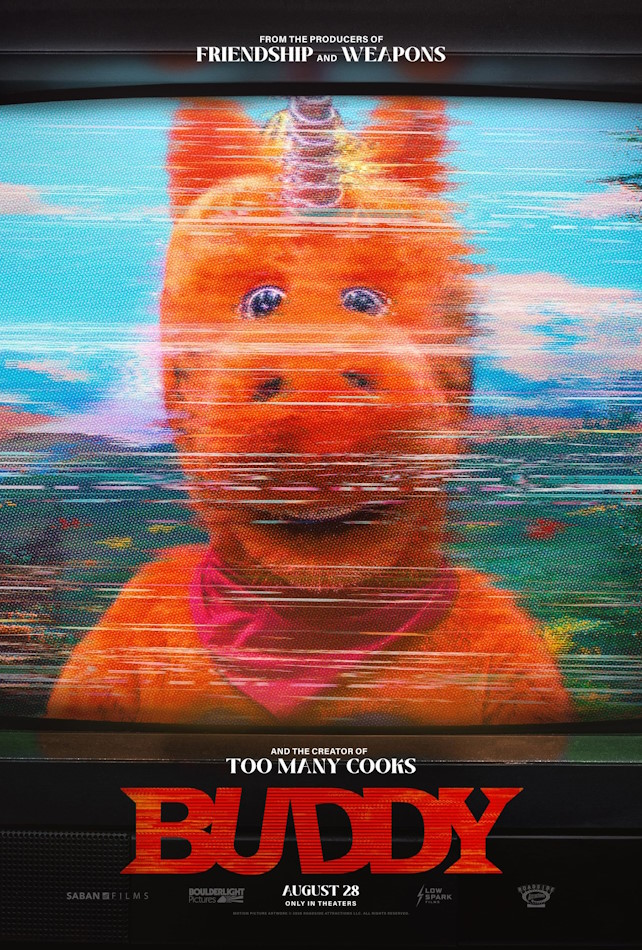

  

{: .img-fluid .rounded }
  

  

... Y si no, animaos a ver [Buddy](https://www.filmaffinity.com/es/film617747.html "Buddy"){:target="_blank"}, una película que responde a la típica pregunta que nos hacíamos de: ¿qué pasaría si a los muñecos de Barrio Sésamo se les fuera la cabeza y empezaran a masacrar a los niños del plató? ¿No?

La dirige Casper Kelly, el chalado que hizo aquel corto de [Too Many Cooks](https://www.filmaffinity.com/es/film913042.html "Too Many Cooks"){:target="_blank"}, donde parodiaba las cabeceras de las sitcoms con una sintonía y una presentación de personajes que no termina nunca.

Aquí vuelve a esa nostalgia televisiva con colores pastel y canciones absurdas para aprender a compartir, mientras que los chavales van desapareciendo de las formas más salvajes y el show continúa adelante como si nada.

Al menos deja a los niños la lección básica de que si un muñeco gigante pide un abrazo, hay que salir por patas.
  

  {% include carousel.html height="60" unit="%" number="1" %}

