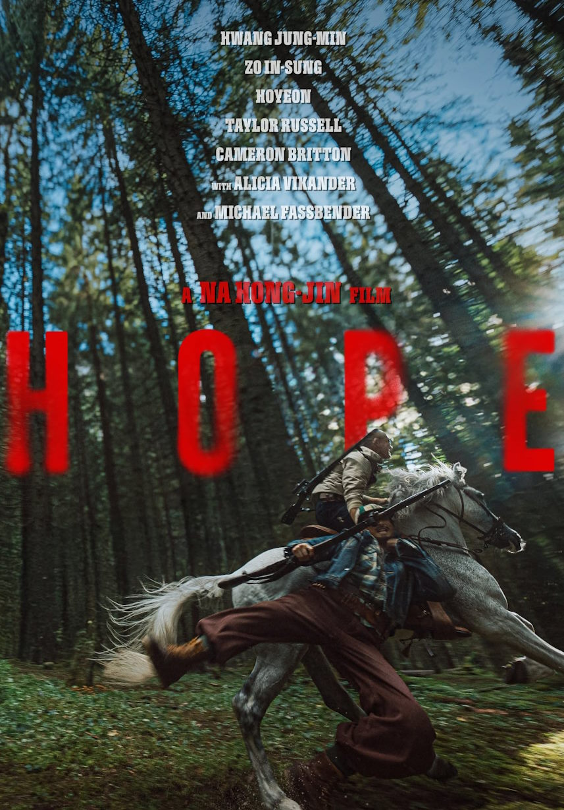

  

{: .img-fluid .rounded }
  

  

... Y si no, animaos a ver [Hope](https://www.filmaffinity.com/es/film761467.html "Hope"){:target="_blank"}, del director de [El extraño](https://www.filmaffinity.com/es/film689813.html "El extraño"){:target="_blank"} y [The Chaser](https://www.filmaffinity.com/es/film377285.html "The Chaser"){:target="_blank"}, que vuelve con una bestia destrozando un pueblo costero de Corea.

Si queréis acción, aquí tenéis acción. 2 horas y media de persecuciones. No es exagerado, 2 horas y media de persecuciones. Lo único que cambia es que la primera hora no sabes qué persiguen y la segunda quién persigue a quién.

Salen Michael Fassbender y Alicia Vikander, seguro que en uno de sus papeles más raros hasta la fecha. Y tiene pinta de que va a haber secuela, pese a no estar al nivel de las comentadas.

2 horas y media de persecuciones. 
  

