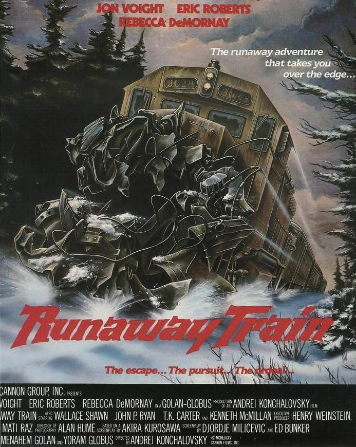

  

{: .img-fluid .rounded }
  

  

... Y si no, animaos a ver [El tren del infierno](https://www.filmaffinity.com/es/film985935.html "El tren del infierno"){:target="_blank"}, donde dos reclusos se fugan de una cárcel y se meten en un tren cuyo maquinista sufre un infarto, dejando el tren a toda velocidad por la Alaska helada.

Entre el reparto destaca el debut casi accidental de Danny Trejo ([Machete](https://www.filmaffinity.com/es/film906056.html "Machete"){:target="_blank"} o [Abierto hasta el amanecer](https://www.filmaffinity.com/es/film830168.html "Abierto hasta el amanecer"){:target="_blank"}), al que ficharon en pleno rodaje aprovechando su pasado entre rejas para asesorar en las peleas de la prisión.

Curiosa producción de la Cannon, mucho más acostumbrados a la serie B que a rozar premios serios, aquí con locomotoras reales embistiendo toneladas de nieve y metal.

Aunque el verdadero peligro no es descarrilar a doscientos por hora, sino toparte con un Jon Voight tan de mala leche que entiendes perfectamente por qué Angelina Jolie prefirió quitarse el apellido.
  

