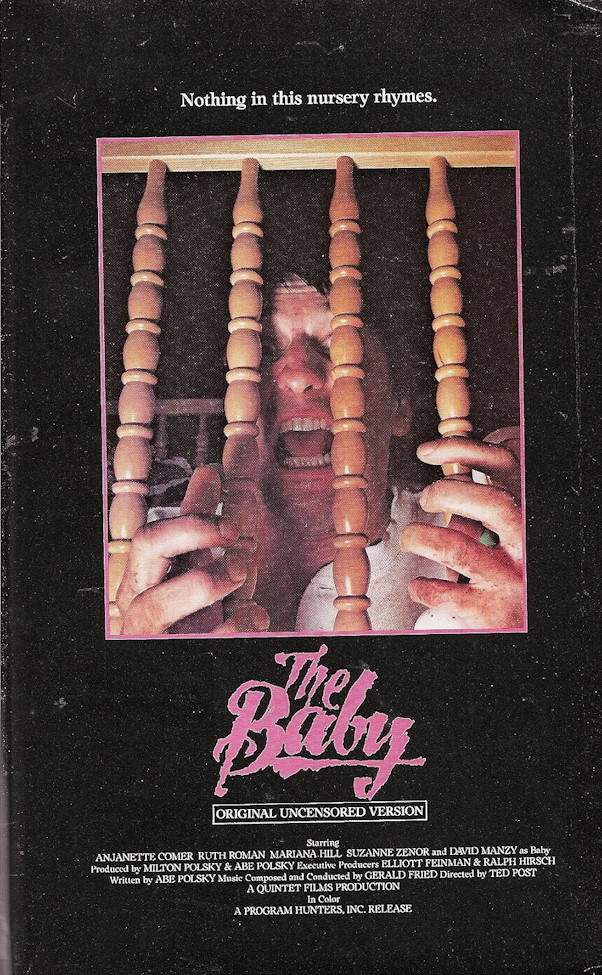

  

{: .img-fluid .rounded }
  

  

... Y si no, animaos a ver [Jaula sin techo](https://www.filmaffinity.com/es/film122841.html "Jaula sin techo"){:target="_blank"}, peli de culto del 73 en la que una trabajadora social investiga a una excéntrica familia y descubre que el "bebé" de la casa, que duerme en cuna y toma biberón, es en realidad un chaval de 21 años.

Dirigida por Ted Post, el mismo tipo que ese año estrenó [Harry el fuerte](https://www.filmaffinity.com/es/film894922.html "Harry el fuerte"){:target="_blank"} (secuela de [Harry el sucio](https://www.filmaffinity.com/es/film571114.html "Harry el sucio"){:target="_blank"}) y que venía de rodar la película favorita de Candal: [Cometeron dous erros](https://www.filmaffinity.com/es/film490679.html "Cometeron dous erros"){:target="_blank"}.

Aquí cambia totalmente de registro y se mete en un enfermizo thriller psicológico de bajo presupuesto, a medio camino entre el terror doméstico y la serie B. 

La película se sostiene a base de incomodidad pura mientras la historia se va enrareciendo hasta un giro final digno de estudio.

Hoy se llevaría diez minutos de aplausos en Cannes como terror elevado sobre traumas generacionales, pero en el 73 tuvieron la decencia de plantar a un tío en pañales y ahorrarnos la chapa.
  

